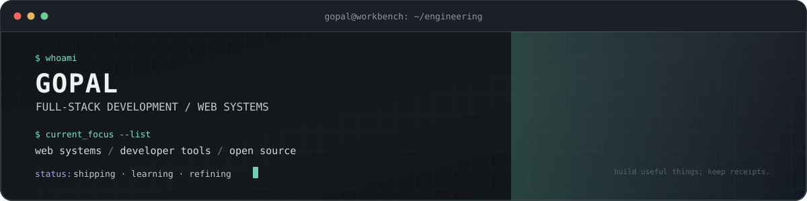

  
   
  

    <a href="https://neoncinematics.in">NEON CINEMATICS · LIVE</a>
    &nbsp;·&nbsp;
    <a href="https://github.com/neon-cinematics/neoncinematics">SOURCE</a>
    &nbsp;·&nbsp;
    <a href="https://github.com/AASTROBOii7/VOXNAV">VOXNAV</a>
    &nbsp;·&nbsp;
    <a href="https://github.com/Gopal2006?tab=repositories">ALL REPOSITORIES</a>
  

  

    <code>FULL-STACK ENGINEERING</code>
    <code>DEVELOPER TOOLING</code>
    <code>VOICE-DRIVEN AUTOMATION</code>
  

About

I'm Gopal, a Computer Science and Engineering student at IIIT Kota. I'm learning full-stack engineering by building working software, understanding how systems behave, and working toward meaningful open-source contributions.
I like software that feels considered: clear interfaces, dependable workflows, and performance that holds up when the content gets heavy. I'd rather reproduce a problem, understand its cause, and make a focused change than add complexity without a reason.
- Building: a deployed media platform and a locally tested voice-driven desktop automation prototype.
- Currently focused on: web engineering, performance optimization, automation, and learning how to contribute to established codebases.
- Open source: learning in public and working toward useful, test-backed contributions.
Selected work
<table>
  <tr>
    <td width="100%">
      <h3><a href="https://github.com/neon-cinematics/neoncinematics">Neon Cinematics</a> <a href="https://neoncinematics.in">LIVE</a></h3>
      
A deployed media and content platform for IIIT Kota's film club, with dynamic publishing and administrative workflows.

      
<code>React</code> <code>Vite</code> <code>GSAP</code> <code>OGL</code> <code>Sanity</code>

      <ul>
        <li>Built and deployed the site, including dynamic content management and media-rich experiences.</li>
        <li>Includes an animated spatial image section and admin workflows for managing content without code changes.</li>
        <li><strong>Current engineering focus:</strong> improving performance on media-heavy pages and the 3D image-space section.</li>
      </ul>
      
<a href="https://neoncinematics.in">Live site</a> · <a href="https://github.com/neon-cinematics/neoncinematics">Source code</a>

    </td>
  </tr>
  <tr>
    <td width="100%">
      <h3><a href="https://github.com/AASTROBOii7/VOXNAV">VoxNav</a> PROTOTYPE · NOT DEPLOYED</h3>
      
A voice-driven desktop automation prototype tested locally. Spoken commands can launch applications and perform supported desktop tasks.

      
<code>Python</code> <code>Voice Commands</code> <code>Desktop Automation</code>

      
<em>Prototype status: tested locally; not currently deployed.</em>

      
<a href="https://github.com/AASTROBOii7/VOXNAV">Source code</a>

    </td>
  </tr>
</table>

Tech Stack

  
  

Languages & Data

  
  
  
  
  
  
  
  
  

Web Engineering

  
  
  
  
  
  
  

AI & Local Models

  
  

Databases, Infrastructure & Tools

  
  
  
  
  
  
  
  

Recent GitHub activity
<!-- PROFILE:START:ACTIVITY -->
Recent public activity will be populated by GitHub Actions after the first refresh.
<!-- PROFILE:END:ACTIVITY -->

Pull requests
<!-- PROFILE:START:PRS -->
Public pull requests will appear here after the first refresh.
<!-- PROFILE:END:PRS -->

GitHub stats
<!-- PROFILE:START:STATS -->
Profile statistics will be populated by GitHub Actions after the first refresh.
<!-- PROFILE:END:STATS -->

  
  

  

Education
B.Tech, Computer Science and Engineering · Indian Institute of Information Technology, Kota
2024–2028
Let's connect

  
  &nbsp;
  
  &nbsp;
  
  &nbsp;
  

