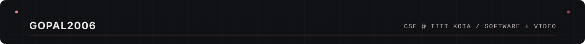

  

  <a href="https://github.com/Gopal2006">GitHub</a> &nbsp;·&nbsp;
  <a href="https://github.com/Gopal2006/Pharos">Pharos</a> &nbsp;·&nbsp;
  <a href="https://github.com/AASTROBOii7/VOXNAV">VoxNav</a> &nbsp;·&nbsp;
  <a href="https://neoncinematics.in">Neon Cinematics</a>

## About

I'm Gopal, a CSE undergrad at IIIT Kota, graduating in 2028. I'm into software because I like figuring out how things work, then building something useful with that understanding.

I learn by making things. When something breaks, I tend to keep poking at it: read the code, check my assumptions, try a fix, and work out why it did or didn't help. I'm especially interested in web development, systems, and getting better at working in codebases I didn't write myself.

Outside coursework, I coordinate Neon Cinematics, IIIT Kota's cinematography and content club. I work across video production and the club's web presence, so I get to move between code, editing, and shoots. I like having both sides of that work in my life.

## Projects

### [Pharos](https://github.com/Gopal2006/Pharos)

A tool I'm building to make unfamiliar public GitHub repositories easier to explore. It reads the repository tree, README, manifests, scripts, configuration, and relevant files, then links findings back to their sources. Its analysis is heuristic; it doesn't execute repository commands.

`React` `TypeScript` `Vite` `GitHub REST API`

### [VoxNav](https://github.com/AASTROBOii7/VOXNAV)

A prototype for voice-driven web navigation and tasks. It experiments with speech recognition, intent detection, follow-up questions when details are missing, and multilingual input including Hindi and Hinglish.

`Python` `IndicWhisper` `Gemini API` `Multilingual NLP`

### [Neon Cinematics](https://neoncinematics.in)

The website and digital home of our student cinematography club. I help coordinate the club and contribute to both the technical side and the video work. The site brings together motion, interactive elements, and a lot of media, which makes performance an ongoing challenge too.

`React` `Vite` `GSAP` `Sanity` `OGL`

## What I'm working on

- Getting better at full-stack development by building projects end to end, including the less exciting parts.
- Practising DSA and contest problems, especially edge cases and understanding why an approach works.
- Finding my way around existing codebases, understanding how they fit together, and making focused open-source contributions.
- Trying local models and AI tools. They can help, but I still want to understand the system behind the API call.

## Tools I use and learn

**Languages**  
`C` `C++` `Python` `Java` `JavaScript` `TypeScript` `SQL` `HTML` `CSS`

**Web development**  
`React` `Vite` `Next.js` `Tailwind CSS` `Node.js` `Express` `REST APIs` `PostgreSQL` `MongoDB` `Supabase`

**Tools**  
`Git` `Linux` `Docker` `Postman` `Ollama` `Hugging Face`

## GitHub activity

  
  

  

## When I'm debugging

- Reproduce the problem and read the surrounding code before changing it.
- Test one idea at a time instead of changing five things at once.
- Check the edge cases, then clean up the fix so it still makes sense next week.
- AI tools can help me move faster, but I still want to understand what I'm committing.

<!-- Add LinkedIn, LeetCode, and CodeChef links once the exact profile URLs are ready. -->

  

